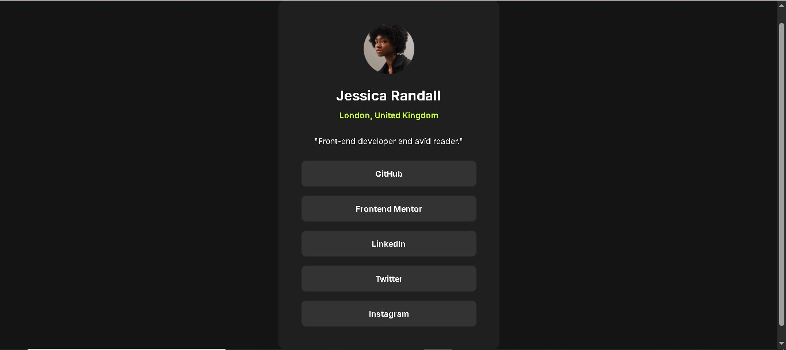

# Frontend Mentor - Social links profile solution

A solution to the [Social links profile challenge](https://www.frontendmentor.io/challenges/social-links-profile-UG32l9m6dQ) on Frontend Mentor (Newbie, HTML/CSS). Built to practise semantic markup, accessible links, and measuring a design instead of guessing at it.

## Table of contents

- [Overview](#overview)
- [Screenshot](#screenshot)
- [Links](#links)
- [Process & decisions](#process--decisions)
- [Built with](#built-with)
- [What I learned](#what-i-learned)
- [AI collaboration](#ai-collaboration)
- [Author](#author)

## Overview

One centered profile card: a circular avatar, a name, a green location line, a one-line bio, and five full-width links (GitHub, Frontend Mentor, LinkedIn, Twitter, Instagram). Plain HTML and CSS, no JavaScript.

The brief was to match the design as closely as possible. The design files cover 375px and 1440px and show a hover state. They show no focus state, so the keyboard focus style is my own design.

Each link points to its service's homepage, not to a real profile. That is deliberate (see below).

## Screenshot

## Links

- Challenge: [Social links profile on Frontend Mentor](https://www.frontendmentor.io/challenges/social-links-profile-UG32l9m6dQ)
- Solution: [github.com/Tarek-Elzoghby/frontend-mentor-challenges/tree/main/social-links-profile](https://github.com/Tarek-Elzoghby/frontend-mentor-challenges/tree/main/social-links-profile)
- Live site: [tarek-elzoghby.github.io/frontend-mentor-challenges/social-links-profile/](https://tarek-elzoghby.github.io/frontend-mentor-challenges/social-links-profile/)

## Process & decisions

### Markup

- **Links are `<a>`, not `<button>`.** They navigate to other sites. A button with a click handler breaks middle-click, open-in-new-tab, and screen-reader link lists.
- **The list is a `<ul>`**, so it is announced as "list, 5 items". `<nav>` is meant for site navigation and was overkill here; bare `div`s give no structure. I added `role="list"` because Safari with VoiceOver drops list semantics once `list-style: none` is set.
- **Name and location sit in an `<hgroup>`.** They are a heading plus its subtitle, and `hgroup` is made for that.
- **The avatar has `alt=""`.** The name is directly beside it, so a descriptive alt would just be read twice. If the avatar were the only thing identifying her, I would write a real description. I also set `width` and `height` on the `` so the browser reserves the space before the file loads.
- **Links go to each service's root.** Invented paths like `github.com/jessicarandall` could belong to real strangers, and a visitor would land on a stranger's account. The visible label stays "Twitter" because the design says so; twitter.com redirects to X.

### Links that open in a new tab

I wanted `target="_blank"`, because on a page where every link is external the profile is home base. That raises an accessibility question: people should be warned before a link opens a new tab (WCAG technique G201). Options I weighed:

- **A visually hidden span inside the link** reads in sequence with the label, translates with the page, and doesn't override anything. Chosen.
- **`aria-label="GitHub, opens in a new tab"`** replaces the visible text for assistive tech, is often left untranslated, and can drift from what is on screen. Rejected.
- **A visible icon plus hidden text** is the most complete option, but the design has no icon and I would have changed the look.
- **A `title` attribute** is not a reliable warning. Rejected.

The honest cost: sighted users get no warning, because I kept the design as drawn. That tradeoff is deliberate and documented here. I also renamed my first class name `hidden` to `visually-hidden`, since `hidden` reads as `display: none` and implies it removes the text for everyone. `display: none` and `visibility: hidden` would also remove it for screen readers, so the hiding rule uses the standard recipe with `clip-path: inset(50%)` in place of the deprecated `clip`.

### Styling the link, not the list item

My first version put a `.button` class on the `<li>` elements. The `<li>` is the box, but the `<a>` is what people click. With the styling on the `li`, only the label in the middle would have been clickable, and the focus ring would have hugged the text instead of the button. It would also have been a small target (WCAG 2.5.8 asks for at least 24px on each side). I moved the styles to `.social-links a` with `display: block`. That makes the whole button the link and needs no class on each anchor.

### Hover and focus

- **Hover is wrapped in `@media (hover: hover)`.** On a touch screen a plain `:hover` leaves the link green after a tap. These links open a new tab, so the visitor would come back to a stuck green button.
- **Focus uses `:focus-visible` with a green outline and no fill.** A fill would make keyboard focus look identical to mouse hover, and you couldn't tell which button is focused while the mouse rests on another. It was suggested to me that a white ring plus fill would be the strongest cue. I kept the green ring because the design has one accent colour and I didn't want to add a second.
- **`outline` instead of `box-shadow`** for the ring, because `outline` survives Windows forced-colors mode. A 2px offset leaves a gap of card colour between the button and the ring.
- **No transition.** The design shows none, and a colour-only fade doesn't need a `prefers-reduced-motion` guard anyway.

### Measuring instead of guessing

Several values were read off the design and checked, not eyeballed:

- **Name:** 24px (`1.5rem`), not the 32px I first wrote. Its width is about 179px in both screenshots, and a 32px name would measure around 240px. Line-height is `1.2` rather than the inherited `1.5`. As a check, 24px x 1.2 + 8px gap + 14px x 1.5 comes to roughly the 33px between the name and location baselines in the desktop screenshot.
- **Font weights:** I rendered 600 and 700 in devtools and compared against the design. The name, the location, and the link labels all measured 700. For the location, the 600 that was suggested to me was wrong; measuring said 700, and the file says 700.
- **Link height:** `0.75rem` of vertical padding plus a 21px line (14px x 1.5) gives 45px, the button height in the design.
- **Avatar:** 88px (`5.5rem`) in the design, not the 96px I first wrote. `object-fit: cover` stops a slightly non-square file from squishing the face.

### Layout

- **Centering:** flex on `main` with `min-height: 100dvh`. `min-height`, not `height`, so a card taller than the screen at 320px width or 200% zoom can't clip its top. `dvh` instead of `vh` because `100vh` on phones is measured as if the address bar were hidden, which leaves the page scrolling for no reason.
- **Page padding is on `main`** (about 24px on mobile) and **card padding is on `.card`** (24px, then 40px from `27rem`). Those are two different paddings, and mixing them up cost me some confusion.
- **One breakpoint, `min-width: 27rem`, mobile-first.** That is where the card reaches its 24rem maximum plus the 1.5rem page padding on each side. The base CSS describes the smallest screen, and the query only adds the larger padding.
- **Spacing is `gap`.** After a universal reset that zeroes margin and padding, every space on the page comes from a written rule. The list is full width because `align-items: center` on the card switches off the default stretch, so children shrink to their content unless told otherwise.
- **Plain CSS with custom properties and `rem` units.** Tailwind is overkill for one component, and Sass adds a build step for almost no gain. Token names describe the role (`--card-bg`, `--accent`), not the value. I renamed `--active` to `--accent` because it collides with the `:active` state and was also used for text where nothing is active.
- **Inter from Google Fonts** with `preconnect` and `display=swap`, and `system-ui` in the fallback stack so the swap is less jarring.

### Checks I ran

These are my own checks, not independent audits.

- **Lighthouse:** performance 99, accessibility 100, best practices 100, SEO 100. SEO first scored 91, and adding a `<meta name="description">` fixed it. Performance 99 comes from render-blocking requests (Lighthouse estimated 780ms on its throttled mobile profile). The Google Fonts request in the Network tab is one woff2 file, 48.5 kB, 438 ms.
- **Responsive:** browser device toolbar plus zooming.
- **Keyboard and screen reader:** checked in devtools.
- **Contrast:** calculated by hand, not read from a tool. White on the button grey is about 12.6:1, dark text on the green hover about 14.8:1, and the green ring and location text on the card about 13:1. Only the green-on-card figure was confirmed with a checker.

### Left open

- **Hover text colour.** The dark text on the green hover uses `--page-bg` directly (grey 900 from the style guide). I did not sample the design screenshot to confirm it is exactly that colour.
- **No `100vh` fallback** above `min-height: 100dvh` on `main`. A browser that doesn't know `dvh` would drop the line.
- **The font request still includes weight 600**, which no rule uses any more after the measurements above.
- **No new-tab cue for sighted users**, as described above.
- **Self-hosting Inter** would remove the third-party round trip and might recover the last performance point. Not done.

## Built with

- Semantic HTML5 markup
- CSS custom properties
- Flexbox
- Mobile-first workflow
- Inter via Google Fonts
- No JavaScript

## What I learned

- `align-items: center` on a flex column makes every child shrink to its content, including a list I wanted full width.
- Style the element people actually click. Putting the button styling on the `li` shrank the hit area and would have made the focus ring hug the text.
- `display: none` hides text from screen readers too. Hiding something visually while keeping it in the accessibility tree takes the visually-hidden recipe.
- A unitless `line-height` is recalculated per element. A fixed value is inherited as that exact number, which would squeeze the 24px name into the body's 21px lines.
- Measure the design before choosing weights and sizes. My first guesses were wrong for the name size, the avatar size, and the location weight.
- Lighthouse 100 for accessibility only covers what a tool can detect. It can't tell me whether the focus ring is visible in practice.

## AI collaboration

I wrote all of the HTML and CSS by hand. An AI collaborator reviewed it. For each real decision it laid out two or three options with a one-line tradeoff and recommended one, and I decided whether to take it. It also wrote the build log this README draws from, at my request, from our conversation.

What it did concretely:

- It flagged problems in my drafts, including the `.button` class on the `li` elements, a `.button` selector that matched nothing because the anchors had no class, the missing `.visually-hidden` rule, invented profile URLs, the `--active` token name, and a global `a` rule that would have stripped underlines from any link added later.
- It was wrong in two places. It guessed 600 for the location weight and my measurement said 700. It also corrected its own earlier accessibility checklist: `prefers-reduced-motion` is about movement, not a colour fade.

What stayed mine:

- Choosing `target="_blank"` with a hidden warning over a visible one, and accepting the cost for sighted users.
- The green focus ring.
- Declining to add a `--text-on-accent` colour that isn't in the style guide.
- Measuring weights and sizes in devtools against the design and running the checks above.

## Author

- Tarek Elzoghby | طارق الزغبي
- GitHub - [@Tarek-Elzoghby](https://github.com/Tarek-Elzoghby)
